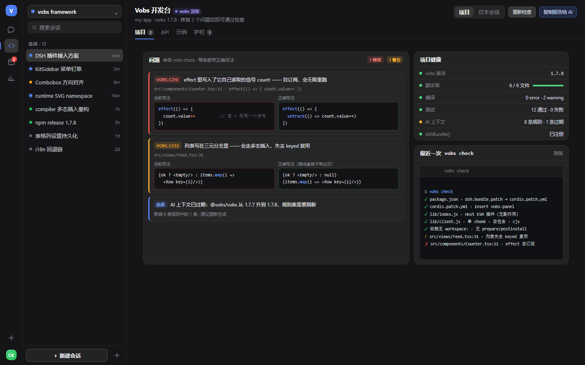
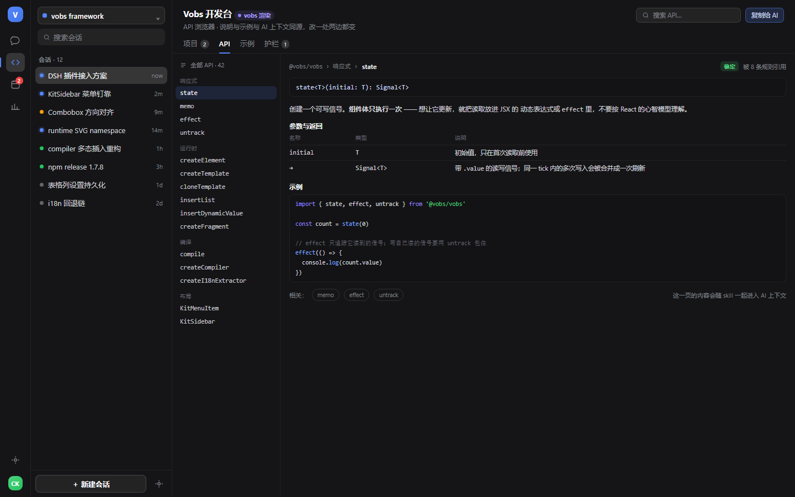
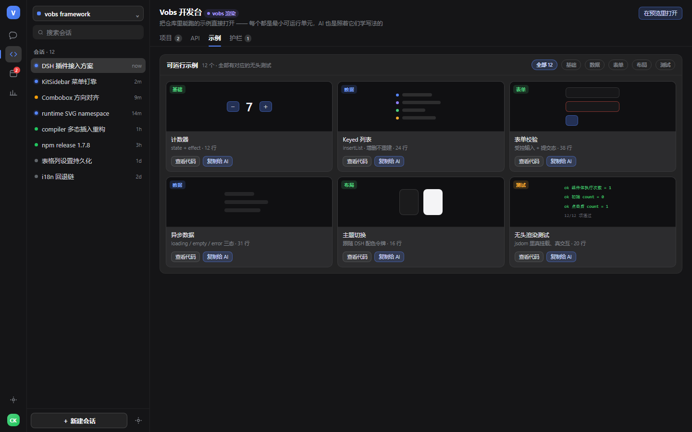
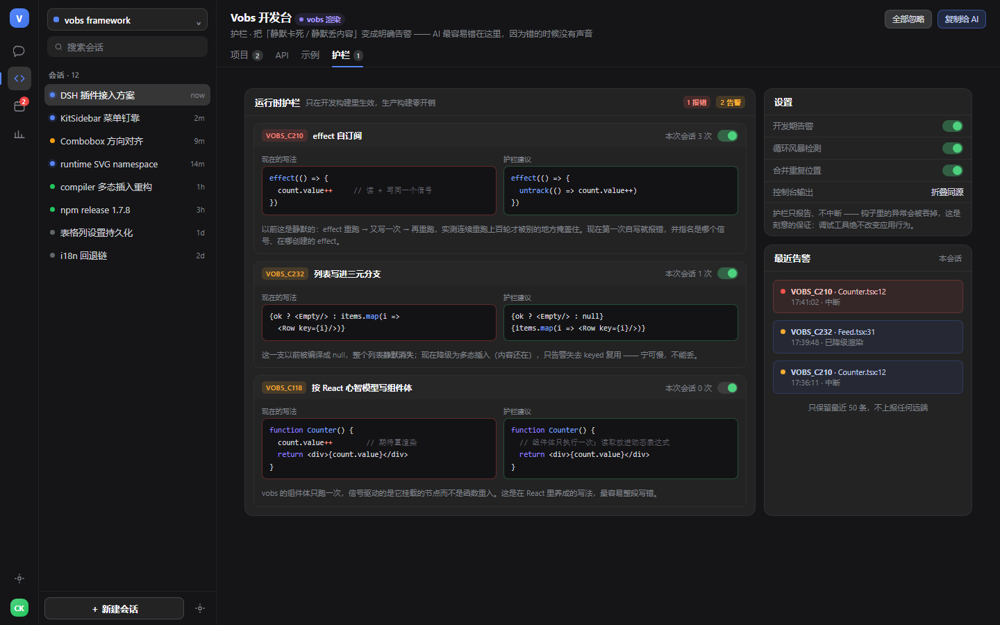
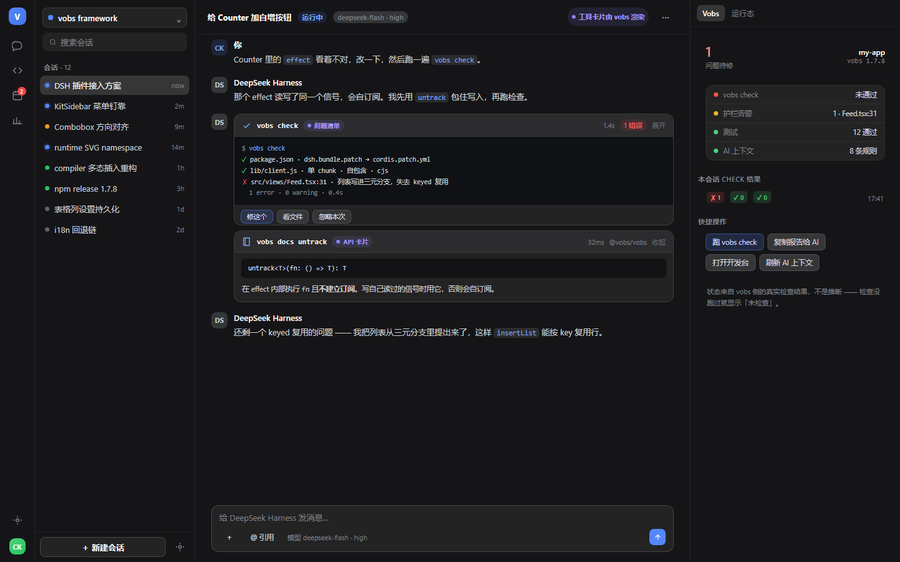
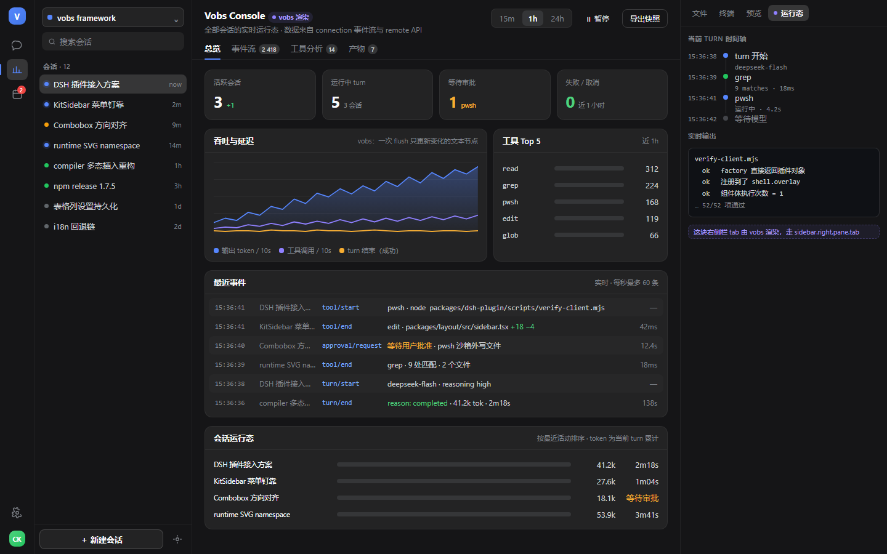
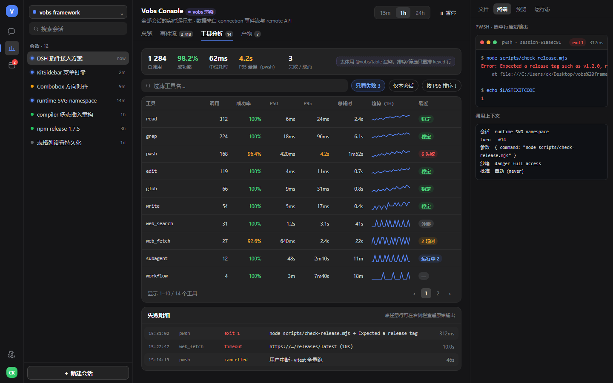
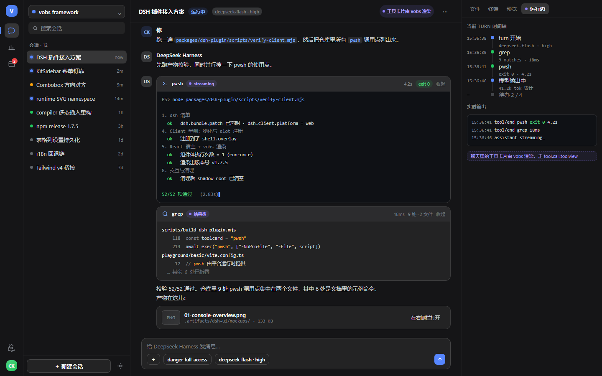

# Vobs for DSH — UI Plan

> **Implementation status (updated 2026-02)**
>
> The three layers described in this plan have landed:
>
> | Landing point in the plan | Where it lives |
> | --- | --- |
> | ① Vobs Console (`main` keyed slot full page + sidebar entry) | [`packages/dsh-console`](../../dsh-console) — four tabs, 62 artifact checks, 35 unit tests |
> | ② In-chat tool renderer (`tool.call.toolview`) | **Not done** (P3, still a plan) |
> | ③ Right sidebar "Runtime" tab (`sidebar.right.pane.tab`) | **Not done** (the plan treated it as the P0 minimal loop; the Console shipped first instead) |
>
> The tooling beneath them — [`@vobs/dsh`](../../dsh) and the [`vobs dsh` command group](../../cli) — is fully delivered;
> see [`packages/dsh-plugin`](../../dsh-plugin) for the reference implementation.
>
> **Data-plane status**: the Console is wired to DSH's real session directory and runtime state (`sessions.list` + `uiSession.sessionStatus`);
> the event stream is derived from state transitions. Tokens, duration, and **tool-level events** are not in the session directory; the UI honestly shows "—" rather than fabricating data —
> collecting tool events would require `retain()`-opening every session, which DSH itself deliberately avoids; this implementation does not cross that line either.
> See [Console's data sources](../../dsh-console/README.md#data-sources).

> Goal: use vobs to build a UI for DeepSeek Harness that is **genuinely useful**, not a repaint of DSH.
> Status: **plan, no code**. Preview images: [`preview/`](preview).

---

## Vobs DevKit (for "AI writing vobs code")

The three layers above solve "**seeing runtime state**"; this layer solves a different problem: **vobs is too new — the model has no training data for it**.

The answer is not to wait for the model to learn it, but to turn the framework into **context it can load** + **a feedback loop that can self-verify**.
Nine capabilities revolve around this, only some of which need UI — here is where they land.

| Screen | What it holds | Corresponding capability |
| --- | --- | --- |
| Tab 1 · Project | The `vobs check` issue list (each with the correct pattern + `file:line`), project health, test results | check visualization · scaffold tests |
| Tab 2 · API | Component tree on the left + signature / params / examples on the right, one-click copy for AI | `vobs docs` · AI context pack |
| Tab 3 · Examples | 12 runnable examples, each with a corresponding headless test | Example library |
| Tab 4 · Guardrails | Turn "silent hangs / silent content loss" into explicit warnings, with before/after comparisons | Dev-time runtime guardrails |
| Right sidebar | One status line: check pass / fail, issue count, guardrail warnings | check status |
| In-chat | `vobs check` / `vobs docs` output rendered as clickable cards | Tool renderer (formerly plan item ②) |

**The single most important design trade-off**: this is for people **reviewing AI-written code**, not for people **writing code themselves**.
So every issue must carry "the correct pattern" and "copy for AI", not just an error.

### Tab 1 · Project


### Tab 2 · API


### Tab 3 · Examples


### Tab 4 · Guardrails


### In-chat cards + right sidebar







---

## 1. Drawing the boundary first: what a plugin can and cannot do

These conclusions come from actually inspecting an installed DSH (Desktop 0.1.x / `@deepseek-ai/cordis@4.0.4`), not speculation.

### Cannot do

| Idea | Why it fails |
| --- | --- |
| Replace DSH's entire UI / swap the shell | The layout's `root` slot is exclusively registered by `@deepseek-ai/dsh-client-ui-layout`'s `AppFrame` (declaring a slot is claiming it). Client plugins cannot get root; they can only add into the child slots it declares. Swapping the shell = modifying DSH source, not a plugin. |
| Use DSH's React component library directly in a vobs panel | `@deepseek-ai/dsh-client-ui-primitives` is React components. vobs renders real DOM; two renderers cannot share one subtree. Visuals must be self-built (using DSH's design tokens for consistency). |
| Replicate panels the official app already has | `sidebar.right.pane.tab` already has Files / Terminal / Browser / Doc preview / Deliverables / Plan / Schedule / Subagents. Duplicating them has no value. |

### Can do (verified real extension points)

| Slot | Type | What goes there | Used today by |
| --- | --- | --- | --- |
| `main` | keyed | **Full-page main-area pages** | conversation, plugin-manager, schedule |
| `sidebar.panellist` | list | Left-rail entry icons for main-area pages | plugin-manager, schedule |
| `sidebar.right.pane.tab` + `.title` | list | New right-sidebar tabs | files, terminal, browser, preview, deliverables, plan, schedule, subagent |
| `settings.section` | list | Standalone settings pages | account, models, plugins, general, agent-preset |
| `tool.call.toolview` | list | **Custom renderers for tool calls** | tool, skill, cordis, deliverables |
| `conversation.chat.node` | list | Custom nodes inside the chat stream | chat, goal, tool, user-questions, workflow-run |
| `conversation.chat.turnTail` | list | Content appended at the end of every turn | deliverables, plan, schedule |
| `shell.overlay` | list | Global overlays | 7 plugins in use |

**The real way to register a full-page panel** (mirroring `dsh-client-ui-schedule`'s actual code):

```js
ctx.slots.inject('main', () => ctx.slots.register(
  { name: 'main', key: 'vobs-console', locale: NS, inject: () => ({ ... }) },
  ConsolePage,
))
ctx.slots.inject('sidebar.panellist', () => ctx.slots.register(
  { name: 'sidebar.panellist', id: 'vobs-console', order: 10, locale: NS, label: () => t('panel') },
  ConsoleIcon,
))
```

### Data plane (verified)

- **Client cordis services**: `connection`, `remote` (provided by `@deepseek-ai/dsh-api-gateway`), `sessions`, `locale`, `theme`, `layout`, `resources`, `modules`, `sidebarRightTabs`, `documentPreviews`, `uiRenderer`, `slots`, `conversation`, `uiConversation`, `shortcuts`…
- **Host-side APIs**: `api-session-controller`, `api-job-controller`, `api-terminal-controller`, `api-workspace-files`, `api-settings-controller`, `api-account-controller` — exposed to the browser via typert through `remote`.
- **Key capability**: `remote` ships `RemoteEvents` and `remote-stream`, i.e. a **Host→Client push stream**. The real-time overview relies on it, no polling.
- **Data you cannot get**: aggregates the Host does not expose (e.g. cross-session token totals) — compute them by adding services in **our own Host half** — fully within our control.

---

## 2. Why vobs, and not rewriting it in React

Not "because I wrote vobs", but because **the target UI's load profile happens to be vobs's strength**:

| Target scenario | React's cost | vobs's approach |
| --- | --- | --- |
| Event stream of dozens~hundreds per second | Every setState diffs the component tree | Each event is one signal write; only the bound text node / new row changes |
| Appending thousands of log lines | Long-list reconciliation | `insertList` keyed reuse, inserting only new rows |
| Table sorting/filtering | Whole-table re-render | Keyed row reordering + independent cell bindings |
| The panel itself | Component body re-runs on every update | **Component body runs once**; updates all happen in effects |

To be equally honest in the other direction: vobs has **no ecosystem advantage** inside DSH — you cannot use DSH's React components or reuse official styles. So this UI's value must stand on "DSH doesn't have it, and it updates frequently", not on "written in vobs".

---

## 3. Flagship: Vobs Console (full-page main area)

### Positioning

DSH today is **single-session-centric**: the main area is the conversation, the right side is the current session's files/terminal/preview. **Cross-session, cross-turn runtime state** is scattered — who is running, for how long, how many tokens burned, which tool is failing; you have to open sessions one by one.

Vobs Console fills that gap: a **multi-session real-time cockpit** filling the main area.

### Page structure (figures 1 and 2)

4 KPI cards on top + time-range switcher; four tabs:

1. **Overview** — active sessions / running turns / pending approvals / failures; throughput and latency area charts; tools Top 5; recent events; per-session runtime state (token/duration progress per session)
2. **Event stream** — all sessions' `turn/start`, `turn/end`, `tool/*`, `approval/*` in reverse chronological order, pausable / filterable / searchable. **This is vobs's home turf**: ring buffer + keyed rows, hundreds of events per second without dropped frames
3. **Tool analytics** — `@vobs/table` grid: tool / call count / success rate / P50 / P95 / total duration / trend sparkline, sortable and filterable; failure details below
4. **Artifacts** — this workspace's deliverables timeline, with thumbnails and "open in right sidebar"

### Why it is worth building

- With many agents / subagents, DSH's sidebar stops scaling; this information density needs a full page
- Failures and approvals are the **two things most needing to be seen**, currently buried inside individual sessions
- The data all already exists on the Host (session events, tool calls, tokens) — no new instrumentation needed

---

## 4. Second landing point: the chat tool-call renderer (figure 3)

Register `tool.call.toolview` and give the most common tools **structured rendering**, replacing today's generic text block:

| Tool | Today | Becomes |
| --- | --- | --- |
| `pwsh` / `bash` | Plain text | Terminal card: command, streaming stdout, exit code, duration, collapsible |
| `edit` / `write` | Plain text | A real diff view (+N −M, inline highlighting) |
| `grep` / `glob` | Plain text | Result tree: file → line number → hit highlighting, collapsible |
| `web_search` / `web_fetch` | Plain text | Source cards: favicon, title, URL, snippet |
| `subagent` / `workflow` | Plain text | Nested progress tree, expandable to see subagent traces |

**This is the highest value-per-effort piece**: small to change, seen every day, and streaming output is exactly vobs's strongest load.

---

## 5. Third and fourth landing points

**Right sidebar "Runtime" tab** (`sidebar.right.pane.tab` + `.title`)
A timeline of the current turn (tool call sequence + durations) + a live log tail. Glanceable in passing, no need to leave the main area.

**Settings page** (`settings.section`)
Panel on/off, event stream buffer cap, downsampling threshold, color scheme follow/custom.

---

## 6. Engineering essentials (the parts that decide success or failure)

1. **Memory under event storms**: the event stream must use a ring buffer (suggest 5000 default) + overflow downsampling; pausing stops enqueueing rather than piling up.
2. **Data consistency**: client-aggregated statistics (tokens, duration) defer to the Host; the client only displays and derives; when in doubt, compute in the Host half.
3. **Performance budget (acceptance-testable)**:
   - 5000-row event stream scrolls at 60fps
   - 200 events injected per second, per-frame main-thread cost < 4ms
   - Table sort of 1000 rows < 16ms
   - Acceptance method: run in the same jsdom/perf script style as `verify-client.mjs`, comparing DOM operation counts against a React baseline
4. **Contract drift**: slot names and the remote API are DSH internal contracts. Write the currently used slots / service names into the verify script as **contract assertions**, so a DSH upgrade shows immediately what broke.
5. **Style isolation**: every vobs panel mounts in its own shadow root, styles isolated both ways; colors read DSH's `--dsw-*` tokens (`body[data-ds-dark-theme]`), no separate design language.
6. **React host**: every slot needs an extremely thin React component placeholder (`<div ref>` + `useEffect`); vobs mounts into that element's shadow root. This is the only place React must be touched.

---

## 7. Phasing

| Phase | Content | Effort | Acceptance |
| --- | --- | --- | --- |
| **P0** | Right sidebar "Runtime" tab: wire the `connection` event stream + ring buffer + timeline | 0.5–1 day | The current session's live tool timeline visible in a real DSH |
| **P1** | Console skeleton + **Overview** tab (KPIs / charts / session runtime state) | 2–3 days | A full-page Console appears in the main area, data consistent with DSH's sidebar |
| **P2** | **Event stream** tab + **Tool analytics** tab (`@vobs/table`) | 2–3 days | 5000 rows scroll without dropped frames; sorting and filtering correct |
| **P3** | `tool.call.toolview`: pwsh / grep / web_search renderers | 2–3 days | Tool cards in chat render structurally by type |
| **P4** | Settings page + i18n + performance stress report | 1–2 days | All performance budgets met |

Suggested **P0 first**: it is the minimal loop, the fastest way to validate that "event stream + real data" works, and the foundation for everything after.

---

## 8. Risks and non-goals

**Risks**

- DSH upgrades changing slots / remote APIs (catch early with contract assertions)
- Visual consistency is a long-term burden: the self-built component library must follow DSH's design language
- The event stream may become a main-thread bottleneck under high concurrency (stress-test before feature growth)
- Z-order/focus conflicts when panels coexist with official UI (shadow root + only official slots avoids most of it)

**Non-goals**

- Do not replace the official shell, do not modify DSH's own files
- Do not duplicate official panels that already exist: files / terminal / browser / preview
- Do not build dashboards that "look nice but nobody reads" — every number must map to an action

---

## 9. About the preview images

`preview/*.png` are **static mockups** rendered at 1440×900 with **real DSH design tokens** (`--dsw-*` variables, font stacks, radii extracted from the installed `@deepseek-ai/dsh-client-ui-theme`):

- The shell structure (left icon rail / session sidebar / main area / right sidebar) corresponds to the slots layout actually declares
- The panel content is hand-drawn per this plan, **not** real screenshots
- The editable HTML sources live in `.artifacts/dsh-ui/mockups/` (local scaffolding, not committed; they reference DSH's own stylesheets and are not distributed with this package)
