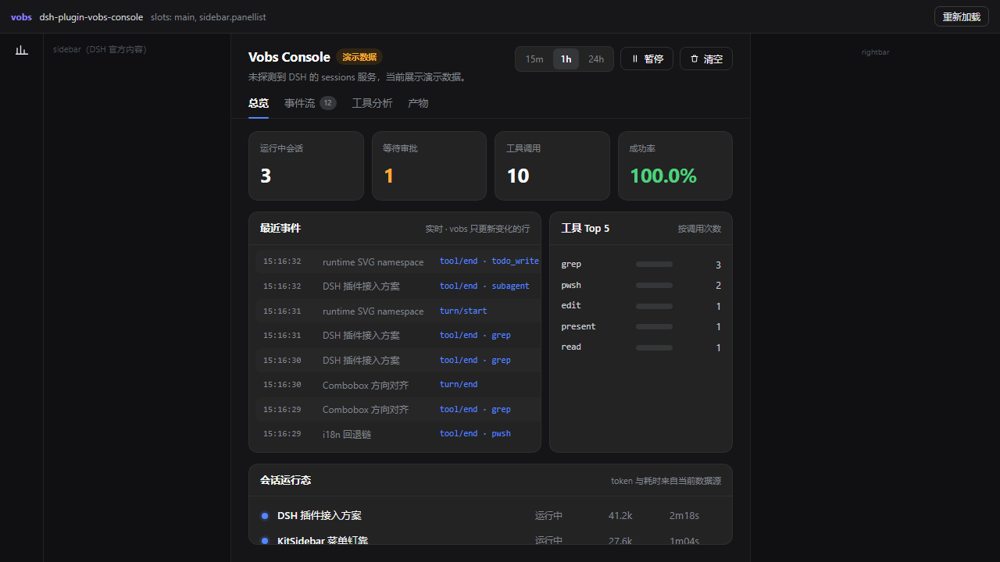

# @vobs/dsh

The adapter layer for building **DeepSeek Harness (DSH)** client plugins with **vobs**.

It handles for plugin authors the three most pitfall-prone parts of a DSH client plugin that have nothing to do with business logic:

| What you'd worry about | Before | Now |
| --- | --- | --- |
| Artifact shape | Wrap the CJS bundle yourself into `window.__ModuleLoader__.load({id, factory})`, add `module`/`exports` shims | `dshBundle()` does it automatically |
| Artifact purity | Split chunks, dynamic `import()` — only discovered broken once installed in DSH | Fails at build time with an explanation |
| React host | Hand-write `<div ref>` + `useEffect` + shadow root + cleanup for every slot | One line with `createVobsSlotHost` |
| slot registration | Hand-write `ctx.slots.inject(...)` + `register(...)`, guessing at fields | `defineDshOverlay` / `defineDshPanel` |
| Color scheme | Detect dark vs light DSH yourself | The host writes `data-scheme` automatically |
| Types | `ctx: any` | Fully typed `DshClientContext` |
| Local development | Only visible once installed in a real DSH | `vobs dsh dev` + `@vobs/dsh/preview` |



*The screenshot above is a real capture of an external plugin project running `vobs dsh dev` (1280×720, headless browser). The left rail is the `sidebar.panellist` entry; the main area is the full-page panel in the `main` slot. Nothing was ever installed into DSH.*

---

## Up and running in 30 seconds

```bash
pnpm add -D @vobs/dsh @vobs/vobs @vobs/vite-plugin vite
```

**package.json** — the `dsh` manifest is the only credential by which DSH recognizes a plugin:

```json
{
  "name": "my-dsh-plugin",
  "type": "module",
  "exports": {
    ".": "./lib/index.js",
    "./client": "./lib/client.js",
    "./cordis.patch.yml": "./cordis.patch.yml",
    "./package.json": "./package.json"
  },
  "dsh": {
    "manifestVersion": 1,
    "bundle": { "patch": "./cordis.patch.yml" },
    "client": { "platform": "web" }
  }
}
```

**cordis.patch.yml** — inserts your own line into the profile's cordis tree:

```yaml
- insert:
    - id: my-plugin
      name: my-dsh-plugin
```

**vite.config.ts** — `dshBundle()` takes care of the artifact shape:

```ts
import { defineConfig } from 'vite'
import { vobsPlugin } from '@vobs/vite-plugin'
import { dshBundle } from '@vobs/dsh/vite'

export default defineConfig({
  plugins: [
    vobsPlugin(),
    dshBundle({ entry: 'src/client/index.tsx' })
  ]
})
```

**src/client/index.tsx** — business code is reduced to "where to mount" and "what to render":

```tsx
import { defineDshOverlay } from '@vobs/dsh'
import { Panel } from './panel'

export default defineDshOverlay(
  { id: 'my-panel', order: 120, styles: PANEL_CSS },
  () => <Panel />
)
```

After `pnpm vite build`, `lib/client.js` is the bundle DSH can load directly.

---

## The three registrars

### `defineDshOverlay(options, render)` — global overlay

Mounts into `shell.overlay` (DSH's own quota notice and the plugin-manager toast live here too). Fixed to the bottom-right corner of the window by default.

```tsx
export default defineDshOverlay(
  { id: 'my-panel', order: 120, styles: css, label: 'My panel' },
  () => <Panel />
)
```

### `defineDshPanel(options, render)` — full-page main area

Mirrors how the official `ui-schedule` registers: `main` is a **keyed** slot claimed by `key`; `sidebar.panellist` uses the same value as its `id` to link up, which makes the entry appear in the left sidebar.

```tsx
export default defineDshPanel(
  {
    key: 'my-console',
    label: 'My Console',
    sidebarEntry: {
      label: 'Console',
      renderIcon: () => <ConsoleIcon />
    }
  },
  () => <Console />
)
```

### `defineDshPlugin(spec)` — the escape hatch

Use when you need to write `apply` yourself or register into a slot the adapter has not wrapped yet:

```tsx
import { defineDshPlugin } from '@vobs/dsh'

export default defineDshPlugin({
  inject: ['connection', 'remote'],
  setup(ctx) {
    const connection = ctx.get('connection')
    // …your own wiring…
    return () => { /* runs on teardown */ }
  }
})
```

Slots not covered by the adapter are just as safe to use through the low-level API:

```tsx
ctx.slots.inject('sidebar.right.pane.tab', () =>
  ctx.slots.register({ name: 'sidebar.right.pane.tab', key: 'my-tab' }, host)
)
```

---

## What `dshBundle()` does

1. **Wraps the artifact** — takes rollup's CJS output and wraps it into a single
   `window.__ModuleLoader__.load({ id, factory })` registration,
   injecting `module` / `exports` shims so the CJS artifact runs as-is; the return
   value prefers the `default` export.
2. **Three-condition white gate** (violations fail the build, with instructions on how to fix):
   - there must be **exactly one chunk** — DSH only supports self-contained chunks;
   - there must be **no standalone assets** — CSS must be inlined as strings (e.g. injected into a shadow root);
   - the output format must be **cjs**.
3. **Platform module externalization** — `react` is forced external (it is a built-in entry in DSH's platform module table;
   bundling it would produce a second copy), and `globalThis.__VOBS_DSH_REACT__ = require('react')` is injected as the
   first line of the factory.

Options:

| Option | Default | Description |
| --- | --- | --- |
| `id` | package.json's `name` | Browser module identity |
| `entry` | — | When given, also fills in `build.lib` (cjs / single file) |
| `platformModules` | `['react']` | Additional platform modules to externalize |
| `fileName` | `client.js` | Output file name |
| `react` | `true` | Set `false` to disable React bootstrap injection (when you call `useDshReact` yourself) |

At build time it also checks whether package.json has a `dsh.client` field; if missing, you get a warning instead of discovering it only after installing into DSH.

---

## React bindings

DSH slots only accept React components; vobs renders real DOM. The adapter's approach:
**use an extremely thin React component to occupy one element, open a shadow root on that
element, and mount the vobs application into it.**
On the React side there is forever only this one empty shell; all business code lives in vobs.

React is obtained through `resolveDshReact()`, two paths:

1. Injected automatically by `dshBundle()` at build time (the default, no code needed);
2. Manually `useDshReact(require('react'))` when using your own build pipeline.

If neither is available, an error with a fix suggestion is thrown.

---

## DSH contract quick reference

All of these are **unofficial contracts reverse-engineered from an installed DSH** and may drift when DSH upgrades. The adapter therefore only commits to "conservative declarations":
all DSH-specific fields are optional, and unknown fields pass through untouched.

| Location | Requirement |
| --- | --- |
| `package.json` → `dsh.bundle.patch` | Patch file path (relative to package root) |
| `package.json` → `dsh.client.platform` | `'web'` for the web client |
| `package.json` → `dsh.client.inject/external/immediately` | Optional. `inject` lists client packages to load first; `external` lists module requests outside the platform table |
| `exports['.']` | Host-side cordis plugin module (ESM, exports `name` / `inject` / `apply`) |
| `exports['./client']` | Prebuilt browser bundle |
| Install-time scripts | **No** `prepare` / `postinstall`; artifacts must be committed |
| Dependencies | Zero if possible, and no `workspace:` protocol (unresolvable in a Git subdirectory install) |

Common slots:

| slot | Shape | What goes there |
| --- | --- | --- |
| `main` | keyed | Full pages in the main area |
| `sidebar.panellist` | list | Left-rail entries for main-area pages |
| `shell.overlay` | list | Global overlays |
| `sidebar.right.pane.tab` + `.title` | list | Right sidebar tabs |
| `settings.section` | list | Standalone settings pages |
| `tool.call.toolview` | list | Custom renderers for tool calls |
| `conversation.chat.node` / `.turnTail` | list | Nodes embedded in the chat stream |

`single` slots (`root` / `sidebar` / `rightbar` / `shell.leading`) are already claimed by the official app; plugins cannot get them.

---

## Local preview: `vobs dsh dev`

See your panel without installing it into DSH. `vobs dsh dev` builds the artifact, starts a local server, and creates a DSH-like shell in the browser
(left rail / sidebar / main area / right bar / overlay), rendering every slot entry your plugin registers into its place; code changes rebuild and refresh automatically.

```bash
vobs dsh init my-plugin     # scaffold
cd my-plugin && pnpm install
pnpm dev                    # → http://127.0.0.1:5199/
```

Under the hood is `@vobs/dsh/preview` (usable directly too):

```ts
import { startPreview, installLoaderShim } from '@vobs/dsh/preview'

installLoaderShim()                 // install the window.__ModuleLoader__ shim
await loadYourBundleSomehow()       // run the artifact once so it registers its factory
startPreview({
  container: document.getElementById('root')!,
  packageName: 'my-plugin',
  services: { sessions: fakeSessions }   // optional: fed to ctx.get()
})
```

It does not simulate DSH: no backend connection, no cordis, no replication of official component styles. It only answers "what does my panel look like when mounted, and does it throw".
For that it ships a **minimal React implementation** (only `createElement` / `useRef` / `useEffect`),
because the adapter's host component only ever uses those three APIs.

Adding `?static=1` to the page disables the hot-reload connection, convenient for headless screenshots and CI assertions.

## CLI toolchain

| Command | Purpose |
| --- | --- |
| `vobs dsh init [name]` | Scaffolds a **standalone** plugin project (not a monorepo subpackage); the template already contains the manifest, patch, vite config, and `.gitignore` (deliberately not ignoring `lib/`) |
| `vobs dsh dev` | The browser preview above, watching for rebuilds |
| `vobs dsh build` | Builds **both Client and Host halves** — the project's vite.config only handles the Client |
| `vobs dsh check` | Pre-install consistency check: manifest fields, patch inserts, install-time hooks, `workspace:` protocol, artifact shape and purity, whether `require` is down to platform modules only |
| `vobs dsh install` | Assembles the install spec and calls `dsh plugin add`, handling pnpm version and Windows quoting issues along the way |

## Local verification

`@vobs/dsh` ships no verifier; the recommended approach is what `packages/dsh-plugin/scripts/verify-client.mjs` does:
use jsdom to actually run the artifact against DSH's module protocol: register factory → materialize to get the plugin → `apply()` → mount → assert → clean up.

That is currently the only automated acceptance test for this wiring — DSH provides no plugin sandbox.

---

## Known limitations

- **Unofficial APIs**: slot names, `ctx` services, and the `dsh.client` fields were all reverse-engineered from an installed DSH — no official types, no compatibility promises.
- **Not all slots covered**: currently `shell.overlay` and `main` + `sidebar.panellist` are wrapped;
  the rest go through `defineDshPlugin` + low-level `slots.register`.
- **Visuals are DIY**: DSH's React component library (`@deepseek-ai/dsh-client-ui-primitives`) cannot be used inside a vobs panel.
  Consistency is maintained through DSH's `--dsw-*` design tokens.
- **`react` stays external**: even if a plugin never touches React, the artifact carries one line of `require('react')` (platform module, zero cost).
